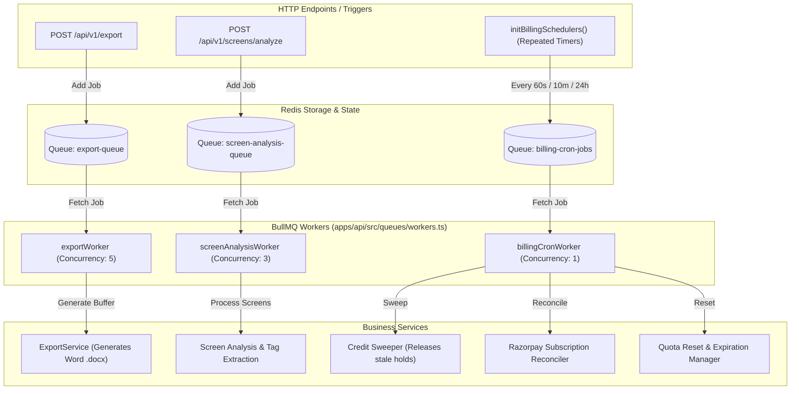

# BullMQ & Background Queue System Architecture

This document explains what **BullMQ** is, why it was chosen for Zibo's architecture, and details all queues, workers, schedulers, and recovery mechanisms running across the platform.

---

## 1. What is BullMQ?

**BullMQ** is a high-performance, distributed, Node.js message queue and job orchestration framework backed by **Redis**.

In a production web application, long-running or resource-intensive tasks (such as AI image processing, file document compilation, and financial cron jobs) must **never run synchronously** inside an HTTP request-response cycle. If they did:
- HTTP requests would time out (browsers/Nginx limit timeouts to 60s).
- Heavy CPU usage (like docx compilation or image conversions) would block Node.js's single-threaded event loop.
- If a server crashes or restarts mid-task, that task would be permanently lost.

**BullMQ solves this by providing:**
1. **Asynchronous Decoupling**: HTTP endpoints return `202 Accepted` with a `jobId` in milliseconds, while workers process jobs in the background.
2. **Reliable Persistence**: Jobs live safely in Redis with atomic states (`waiting`, `active`, `completed`, `failed`).
3. **Concurrency Control**: Limits how many heavy jobs execute simultaneously to prevent server resource exhaustion.
4. **Automatic Retries & Exponential Backoff**: Failed jobs can retry with customizable backoff strategies.
5. **Distributed Scalability**: Workers can run across multiple CPU cores or separate worker machines without race conditions.

---

## 2. Where & How BullMQ is Used in Zibo

Zibo utilizes BullMQ across **three core operational domains**:



---

## 3. Queue & Worker Specifications

### 3.1 Export Queue (`export-queue`)
- **Queue Manager**: `EXPORT_QUEUE_NAME` in [`apps/api/src/queues/queue.manager.ts`](file:///c:/projects/ux-libaray/apps/api/src/queues/queue.manager.ts)
- **Worker**: `exportWorker` in [`apps/api/src/queues/workers.ts`](file:///c:/projects/ux-libaray/apps/api/src/queues/workers.ts)
- **Concurrency**: `5` parallel document builds.
- **Responsibility**:
  - Compiles UX teardowns, side-by-side benchmark comparison cards, and high-resolution screen grids into a formatted Microsoft Word (`.docx`) document.
  - Updates live job progress (`15%` $\to$ `35%` $\to$ `75%` $\to$ `100%`) so the client progress bar updates in real time.
  - Caches the generated base64 artifact in Redis under key `artifact:export:<jobId>` with a 1-hour TTL (`EX 3600`).
  - Frontend polls `GET /api/v1/export/status/:jobId` and immediately initiates download once completed.

---

### 3.2 Screen Analysis Queue (`screen-analysis-queue`)
- **Queue Manager**: `SCREEN_ANALYSIS_QUEUE_NAME`
- **Worker**: `screenAnalysisWorker` in [`apps/api/src/queues/workers.ts`](file:///c:/projects/ux-libaray/apps/api/src/queues/workers.ts)
- **Concurrency**: `3` simultaneous screen analyses.
- **Responsibility**:
  - Handles batch analysis for newly ingested or bulk-uploaded application screens.
  - Calls `markScreensProcessing(screenIds)` to set visual spinners in the UI.
  - Extracts structural UI patterns, hierarchy metadata, and accessibility tags.
  - Ensures clean error handling: if an image fails or format is corrupt, `unmarkScreenProcessing()` is guaranteed to execute so screens don't get stuck in an endless processing state.

---

### 3.3 Billing & Credit Cron Queue (`billing-cron-jobs`)
- **Queue**: `BILLING_CRON_QUEUE` in [`apps/api/src/queues/billing.jobs.ts`](file:///c:/projects/ux-libaray/apps/api/src/queues/billing.jobs.ts)
- **Worker**: `billingCronWorker`
- **Concurrency**: `1` (strict sequential execution to avoid reconciliation races).
- **Scheduled Jobs**:

| Job Name | Interval | Purpose & Invariant Enforced |
| :--- | :---: | :--- |
| `sweep-stale-reservations` | **Every 60s** | **Invariant I5 (Zero-Leak Safety)**: Scans for reservations with status `RESERVED` where `expiresAt < NOW()`. If an LLM stream crashed or network died mid-flight, this releases held credits back to the user's available balance with reason `'Sweeper timeout'`. |
| `reconcile-subscriptions` | **Every 10 min** | **Dropped Webhook Self-Healing**: Checks for subscriptions stuck in `INCOMPLETE` or `PAST_DUE` created > 5 minutes ago. Queries the Razorpay API directly. If paid, it activates PRO and grants 1,000 credits via `fulfilCharge()`. |
| `expire-old-credits` | **Every 24 hrs** | Deducts expired monthly credits for users past their billing renewal cycle. |

---

## 4. How Workers Are Initialized in Production

In the Zibo repository, workers and schedulers are initialized **automatically when the API starts**:

```typescript
// apps/api/src/index.ts
import './queues/workers'; // Registers BullMQ exportWorker and screenAnalysisWorker
import { initBillingSchedulers } from './queues/workers';

// Initializes 60s sweeper, 10m reconciler, and 24h expiration cron
initBillingSchedulers().catch((err) => {
  console.error('[Billing:Schedulers] Initialization error:', err);
});
```

### Process Management with PM2
Because `index.ts` automatically boots the BullMQ workers, **you do not need a separate PM2 worker process**:

```bash
# On your VPS, running the API automatically runs BullMQ:
pm2 start ecosystem.config.js --env production
```

If you ever wish to isolate queue processing to separate background workers (e.g. on dedicated worker nodes):
```bash
# Start workers independently:
pm2 start apps/api/dist/queues/workers.js --name "ux-workers"
```

---

## 5. Monitoring & Redis Health

BullMQ requires a connected Redis server (`REDIS_URL` or localhost:6379).

- **Check Redis Status**:
  ```bash
  redis-cli ping # Returns PONG
  ```
- **Inspect Active BullMQ Keys in Redis**:
  ```bash
  redis-cli keys "bull:*"
  ```
- **Inspect Failed Jobs**:
  ```bash
  redis-cli zcard "bull:export-queue:failed"
  redis-cli zcard "bull:billing-cron-jobs:failed"
  ```

