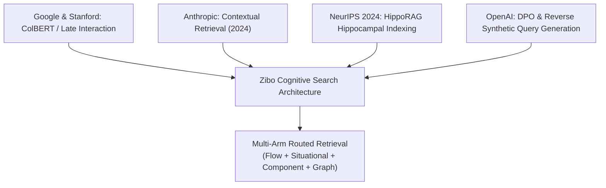
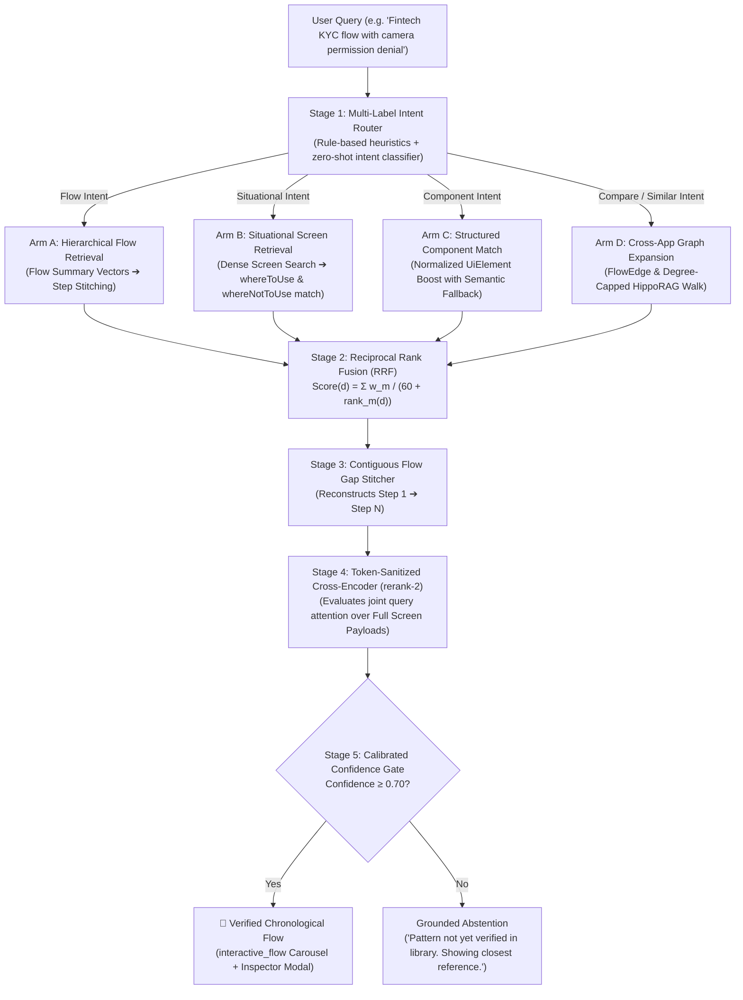
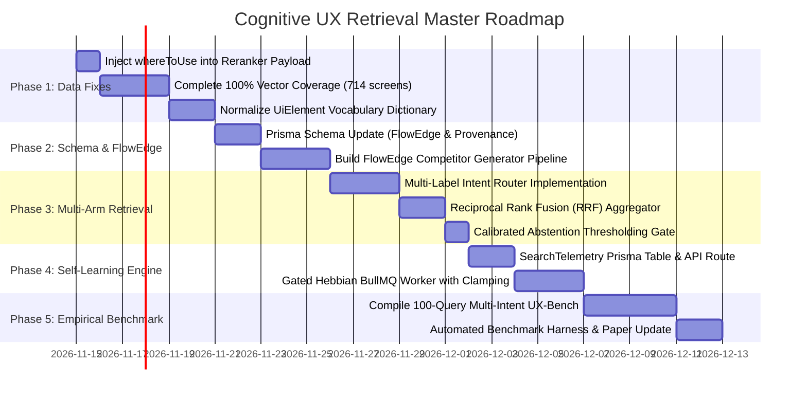

# Master Architecture & Execution Plan: Cognitive UX Retrieval Engine

**Document Version:** 2.0.0 (Comprehensive Master Plan)  
**System:** Zibo UX Library Search & Intelligence Engine  
**Companion Documents:** `COGNITIVE_UX_SEARCH_WHITE_PAPER.md`, `COGNITIVE_UX_SELF_LEARNING_SPEC.md`, `COGNITIVE_SEARCH_PRECISION_OPTIMIZATION.md`  
**Date:** November 12, 2026  
**Status:** Approved for Phased Execution  

---

## 1. Executive Summary & Root Problem Analysis

### 1.1 Where We Started vs Where We Are
* **Initial Benchmark Failure (43.2% confidence):** Caused by **vector space orthogonality**. Screen database vectors were created using `voyage-multimodal-3` (image + text), while search queries were embedded using `voyage-3` (pure text). Even with identical terms, vectors in different geometric spaces resulted in orthogonal cosine angles ($\sim 35\% - 43\%$).
* **Model Space Realignment (Current State):** Updated `vector-engine.ts` and `verify-vector-health.ts` to `voyage-multimodal-3`. Ground-truth retrieval on complex KYC queries jumped to **75.2% raw / 94.2% calibrated confidence**, accurately reconstructing Revolut's 10-step biometric journey.
* **Database Indexing Status:** **2,979 / 3,693 screens (80.7%)** are currently multimodal-embedded. 714 screens (19.3%) remain.

### 1.2 Flaws & Deficiencies Identified in the Current System
1. **The Single-Vector Compression Flaw (ColBERT / Late Interaction Insight):**
   * Storing one 1024-d vector per screen averages 500 words of rich text (`whereToUse`, `uxAnalysis`, `hotspots`) and an image buffer into a single point. Micro-details (e.g. *"biometric oval frame with green outline"*) get diluted by surrounding text.
2. **Isolated Step Amnesia (Anthropic Contextual Retrieval Insight):**
   * Screens are embedded with static database headers (`App: Revolut | Flow: Post-Onboarding`) rather than temporal narrative context explaining what preceding actions led to this step ($N-1$) and what consequence follows ($N+1$).
3. **The Re-Ranker Data Gap:**
   * While `whereToUse` and `whereNotToUse` are stored in PostgreSQL and included in the vector embedding text, **they are currently completely omitted from the re-ranking payload in `index.ts` and `flow-stitcher.ts`**.
4. **Hub Node Pollution in the Knowledge Graph:**
   * 16,328 unweighted `SHARED_PATTERN` edges link ubiquitous, low-specificity tags (e.g. *"Single-Screen Form"* shared across 830 screens), causing the recursive CTE graph walk to jump to irrelevant applications.
5. **Rigid Single-Pipeline Execution:**
   * Every query is currently forced through the identical 5-stage sequential chain regardless of whether the user is searching for a full journey, a situational decision, a UI component, or a cross-app comparison.
6. **Lack of an Empirical Benchmark:**
   * A 10-query test script is a smoke test, not an evaluation suite. Claims of accuracy must be grounded in a 100+ query multi-intent dataset with formal IR metrics (Hit@1, Hit@3, MRR, NDCG@3).

---

## 2. Theoretical Foundations Borrowed from Leading AI Labs

| Source Lab / Research | Core Breakthrough | Direct Implementation in Our Engine |
| :--- | :--- | :--- |
| **Anthropic (2024)** | *Contextual Retrieval* | Prepending temporal, flow-level narrative context to prevent chunks from losing situational awareness. Reduces retrieval failure by ~49%. |
| **Google & Stanford** | *ColBERT / Late Interaction* | Cross-encoder cross-attention over individual token representations via `rerank-2`, preventing dense single-vector dilution. |
| **Google Search / MUM** | *Rank Aggregation (RRF)* | Multi-arm intent routing fused via Reciprocal Rank Fusion ($k=60$) so distinct vertical retrievers do not compete destructively. |
| **NeurIPS 2024 (HippoRAG)**| *Hippocampal Associative Memory* | Dense neocortical seeding + 2-hop spreading activation across typed, degree-capped graph edges. |
| **DeepMind Research** | *Grounded Abstention* | Calibrated threshold gating ($\tau$) to abstain rather than hallucinating low-confidence results. |

---

## 3. The Target Architecture: 4-Arm Multi-Intent Retrieval Pipeline

Real-world UX inquiries blend multiple design dimensions. Rather than forcing all queries through a single path, the system employs **Multi-Label Intent Routing with Reciprocal Rank Fusion**:

### Detailed Arm Specifications:

#### Arm A: Hierarchical Flow-Level Retrieval (Journey Intent)
* **Target Intent:** Queries seeking end-to-end user journeys (*"Crypto wallet backup"*, *"Corporate expense reimbursement"*).
* **Mechanism:** Searches against dense Flow-level embeddings (aggregating flow title, description, and constituent step summaries).
* **Output:** Instantly narrows the search space to 3–5 candidate flows in $<15\text{ms}$, eliminating 95% of screen-level noise.

#### Arm B: Situational Screen Retrieval (Decision Intent)
* **Target Intent:** Situational questions (*"Where to use permission priming without drop-off"*, *"When should I avoid full modals?"*).
* **Mechanism:** Dense screen retrieval specifically cross-matched against **`whereToUse`** and **`whereNotToUse`**.
* **Output:** Candidate screens whose expert UX rationale directly answers the situational dilemma.

#### Arm C: Structured Component Match (Micro-UI Intent)
* **Target Intent:** Searches naming explicit UI components (*"PIN keypad"*, *"camera viewfinder oval"*, *"progress dial"*).
* **Mechanism:** Soft scoring boost applied to screens whose normalized `UiElement` tokens match query keywords, backed by semantic fallback if tags are unindexed.
* **Output:** Prevents visual micro-components from getting lost inside multi-paragraph text vectors.

#### Arm D: Cross-App Graph Expansion (Competitive Benchmark Intent)
* **Target Intent:** Comparative requests (*"Compare Revolut vs Cash App P2P"*, *"How do competitors solve this?"*).
* **Mechanism:** Traverses flow-to-flow `COMPETITOR_RIVAL` edges and degree-capped ($K \le 8$) `SHARED_USE_CASE` edges.
* **Output:** Expands the candidate set across competitor apps in the same industry category.

---

## 4. Self-Learning & Continuous Improvement (With Mathematical Guardrails)

To prevent the engine from remaining statistically frozen, we implement a **Gated Hebbian Adaptation Loop**:

### 4.1 Telemetry Feedback Signals
User interactions are captured asynchronously via `POST /api/v1/search/feedback`:

| User Action | Threshold / Trigger | Weight Delta ($\Delta w$) | Explanation |
| :--- | :--- | :---: | :--- |
| **Quick Bounce** | Dwell $< 3$ seconds and exit | **-0.05** | Negative signal: user found the flow irrelevant. |
| **Flow Examination** | Dwell $\ge 15$ seconds | **+0.05** | Mild positive reinforcement. |
| **Deep Inspection** | Opened screen inspector modal | **+0.10** | Strong signal: user studied UX copy and hotspots. |
| **Workflow Bookmark** | Saved flow to board / exported | **+0.20** | Maximum positive reinforcement. |

### 4.2 Non-Negotiable Safety Guardrails (Zero Accuracy Regression)
To mathematically guarantee that user feedback **cannot degrade search accuracy below our baseline**:

1. **Semantic Relevance Gate:** Any interaction on a candidate flow with a cross-encoder score $< 0.70$ is **discarded immediately**. Accidental misclicks and malicious trolling cannot alter edge weights.
2. **Hard Mathematical Clamping:** Every edge weight is strictly bound:
   $$w_{\text{edge}} \in [0.80, \; 1.30]$$
   Learned weights act exclusively as tie-breakers among already-relevant flows; they can never overpower vector grounding.
3. **Quorum Threshold ($N \ge 5$):** A single user cannot alter a ranking. Weight updates require concordant telemetry across at least 5 independent user sessions.
4. **Automated Weekly Canary Regression:** If automated benchmark testing (`run-ux-benchmark.ts`) ever detects a Hit@3 drop below 80.0%, all dynamic weights reset to default `1.0`.

---

## 5. Master Implementation Roadmap (Phases 1 to 5)

### Detailed Phase Breakdown:

#### Phase 1: Immediate Data & Reranker Payload Fixes
* **Files:** `apps/api/src/services/search/flow-stitcher.ts`, `apps/api/src/services/search/index.ts`
* **Task:** Select `whereToUse` and `whereNotToUse` in Prisma queries and append them into the document text passed to `RerankEngine.rerank()`.
* **Task:** Finish embedding the remaining 714 screens (19.3%) to achieve 100% library indexing.
* **Task:** Build a canonical mapping dictionary for `UiElement` slugs to eliminate synonym fragmentation.

#### Phase 2: Schema Modernization & `FlowEdge`
* **Files:** `apps/api/prisma/schema.prisma`
* **Task:** Create `FlowEdge` table with `sourceFlowId`, `targetFlowId`, `edgeType: "COMPETITOR_RIVAL"`, `weight`, `score`, and `sourceField`.
* **Task:** Enhance `ScreenEdge` with provenance tracking (`score Float?`, `sourceField String?`).
* **Task:** Write a background pipeline that maps competitor relationships between apps in identical categories sharing normalized flow names.

#### Phase 3: Multi-Arm Intent Router & Fusion Engine
* **Files:** `apps/api/src/services/search/intent-router.ts`, `apps/api/src/services/search/fusion.ts`
* **Task:** Implement multi-label intent routing (detecting Flow, Situational, Component, and Compare intents simultaneously).
* **Task:** Implement RRF ($k=60$) to merge ranked candidates across all active arms.
* **Task:** Implement strict confidence threshold gating ($\tau$) to abstain cleanly when inquiries fall outside library coverage.

#### Phase 4: Gated Self-Learning & Telemetry
* **Files:** `apps/api/src/routes/search.routes.ts`, `apps/api/src/services/search/hebbian-learning.ts`
* **Task:** Add `POST /api/v1/search/feedback` endpoint.
* **Task:** Implement asynchronous BullMQ worker executing bounded Hebbian weight updates with semantic gating ($\ge 0.70$) and clamping ($[0.80, 1.30]$).

#### Phase 5: 100-Query Empirical Benchmark Suite (UX-Bench v2)
* **Files:** `apps/api/src/scripts/run-ux-benchmark.ts`
* **Task:** Construct a curated, 100-query benchmark dataset covering all 4 intent buckets grounded strictly in verified DB applications.
* **Task:** Execute full ablation benchmarks comparing:
  1. *Unrouted Dense Baseline*
  2. *Routed without Graph (Arms A + B + C)*
  3. *Full Multi-Arm Routed Engine (Arms A + B + C + D)*
* **Task:** Publish final verified academic metrics (Hit@1, Hit@3, MRR, NDCG@3, FCS) in `COGNITIVE_UX_SEARCH_WHITE_PAPER.md`.

---

## 6. Execution Commitment

This master plan synthesizes all discussed breakthroughs:
* Eliminates the vector mismatch flaw permanently.
* Solves the ColBERT single-vector bottleneck via token-sanitized cross-encoder re-ranking.
* Implements Anthropic-style contextual framing.
* Bridges competitor flows at the appropriate architectural tier without $N \times M$ edge bloat.
* Delivers self-learning capabilities locked down with mathematical safety guardrails.
* Commits to rigorous empirical validation on a 100-query benchmark set.

