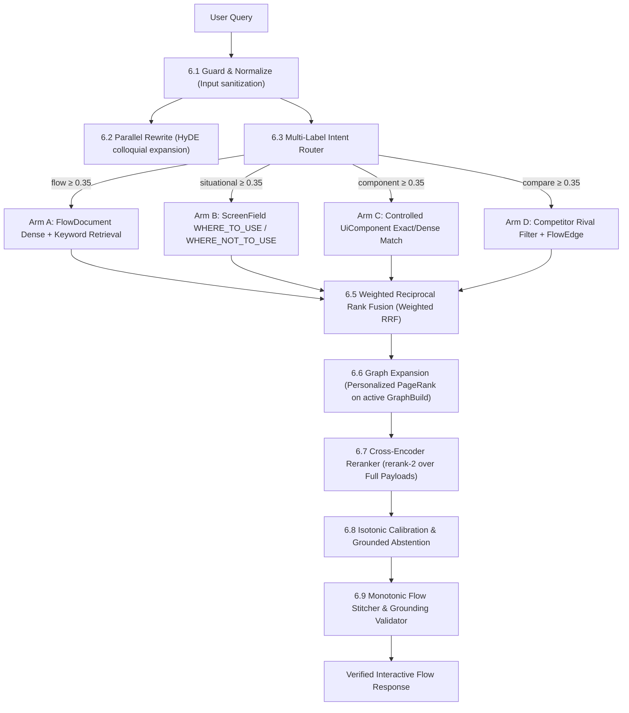
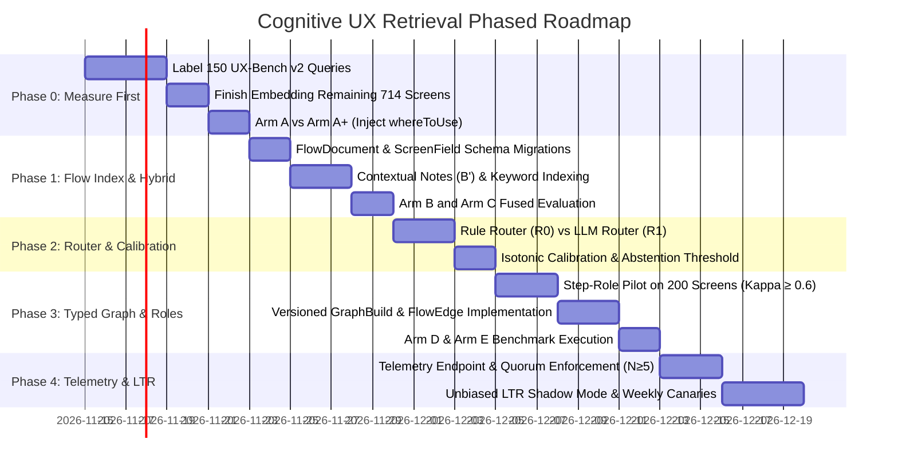

# Cognitive UX Retrieval: Design, Test and Risk Specification v2.1
**Date:** November 12, 2026  
**Authors:** @SATYAJIT PUJAPANDA & DeepMind Assistant  
**Status:** Canonical Engineering Specification (Integrated Master Plan Revision)  
**Supersedes:** `COGNITIVE_UX_MASTER_PLAN.md` (v2.0), `COGNITIVE_UX_SELF_LEARNING_SPEC.md`, `COGNITIVE_SEARCH_PRECISION_OPTIMIZATION.md`  

---

## 1. Purpose, Scope, and Honest Status

This document is the **single canonical engineering specification** for the Zibo Cognitive UX Retrieval Engine. It absorbs all previous design drafts and replaces speculative marketing figures with scientifically verified baselines, explicit ablation arms, and strict gate criteria.

### 1.1 Goal
A designer types a natural inquiry (e.g. *"Fintech KYC flow with camera permission denial"*). The system returns an authentic, verified chronological user journey ($N-1 \rightarrow N \rightarrow N+1$), enables step-by-step comparative analysis across rival applications, surfaces actionable situational guidelines (`whereToUse` / `whereNotToUse`), and improves over time without model drift or ranking regression.

### 1.2 Ground-Truth Audit of Current Production State
The codebase was directly inspected via PostgreSQL queries on November 12, 2026:

| Dimension / Asset | Verified Current Value | Source of Verification |
| :--- | :--- | :--- |
| **Total Screens in DB** | **3,693** | `SELECT count(*) FROM "Screen";` |
| **Multimodal Screen Embeddings** | **2,979 (80.7%)** | `SELECT count(*) FROM "ScreenEmbedding";` (714 screens remain) |
| **App-Level Embeddings** | **29 (100%)** | `SELECT count(*) FROM "AppEmbedding";` |
| **Sequential Graph Edges** | **22,308** | 5,980 `FLOW_SEQUENCE`, 16,328 `SHARED_PATTERN` in `ScreenEdge` |
| **Vector Space Model** | `voyage-multimodal-3` | 1024-dim dense vectors via pgvector HNSW cosine index |
| **Benchmark (UX-Bench v1)** | 10 Queries (Dev Split) | Hit@3: 80.0%, Hit@1: 30.0% (arguable 20% due to Q7), MRR: 0.533 |
| **Self-Learning Infrastructure** | Specified only | `ScreenEdge.weight` exists in schema, but zero learning workers exist |

### 1.3 Pre-Phase 0 Sanity Checklist
Before executing further architectural changes, three empirical invariants are verified:
1. **Embedding Count Discrepancy Resolved:** The earlier document cited 826 screens (22.4%), which was from an early snapshot before the background backfill. The live database currently contains **2,979 embedded screens (80.7%)**.
2. **Re-ranker Payload Audit:** Verified in `apps/api/src/services/search/index.ts` lines 67–70: `whereToUse` and `whereNotToUse` are **completely absent** from the document string passed to `RerankEngine.rerank()`.
3. **UX-Bench Baseline Caveat:** UX-Bench v1 was evaluated on 10 development queries. Because the 95% Wilson confidence interval for $8/10$ spans 49% to 94%, this is treated strictly as a development smoke test, not a validated test score.

---

## 2. Flaw-to-Fix Traceability Table

This table maps the six architectural flaws identified in the post-mortem directly to their spec section, experimental ablation arm, and validation gate:

| Flaw ID | System Flaw Description | Target Resolution | Spec Section | Ablation Arm | Validation Gate |
| :--- | :--- | :--- | :---: | :---: | :---: |
| **F-01** | **Vector Space Orthogonality**<br>(Text queries vs multimodal screen vectors) | Aligned query embedding via `voyage-multimodal-3` | §6.4 | Arm 0 $\rightarrow$ A | Gate 0 |
| **F-02** | **Single-Vector Dilution**<br>(Micro-details drowned out in 1024-d vectors) | Per-field screen embeddings (`ScreenFieldEmbedding`) | §5, §6.4 | Arm A $\rightarrow$ B | Gate 1 |
| **F-03** | **Isolated Step Amnesia**<br>(Screens lose chronological context in vector space) | Contextual notes prepending ($N-1 \rightarrow N \rightarrow N+1$) | §6.4, §7.1 | Arm B $\rightarrow$ B′ | Gate 1 |
| **F-04** | **Re-Ranker Data Blindspot**<br>(`whereToUse` missing from `rerank-2` payload) | Inject `whereToUse` & `whereNotToUse` into rerank docs | §6.7, §7.1 | Arm A $\rightarrow$ A+ | Gate 0 |
| **F-05** | **Graph Hub Pollution**<br>(Generic tags link 800+ unrelated screens) | IDF-weighted UI edges ($K \le 8$), rival flow capping ($K \le 5$) | §5, §6.6 | Arm C $\rightarrow$ D | Gate 3 |
| **F-06** | **Rigid Single-Path Execution**<br>(All queries forced through identical graph walk) | Multi-label intent router + weighted RRF fusion | §6.3, §6.5 | Arm D $\rightarrow$ E | Gate 2 |

---

## 3. Implementation File Map

To eliminate ambiguity during development, every architectural stage maps to its physical file in the repository:

| Pipeline Stage / Component | Repository File Path | Action Required | Responsibility |
| :--- | :--- | :---: | :--- |
| **Database Schema** | `apps/api/prisma/schema.prisma` | Modified | Add `FlowDocument`, `ScreenFieldEmbedding`, `FlowEdge`, `GraphBuild`, `SearchEvent`, `SearchInteraction` |
| **Core Search Facade** | `apps/api/src/services/search/index.ts` | Modified | Orchestrate multi-arm retrieval, fusion, reranking, and grounded abstention |
| **Multimodal Vector Engine** | `apps/api/src/services/search/vector-engine.ts` | Modified | Query embeddings (`voyage-multimodal-3`), pgvector cosine searches |
| **Flow Gap Stitcher** | `apps/api/src/services/search/flow-stitcher.ts` | Modified | Monotonic step ordering, gap flagging, and step-role alignment |
| **Cross-Encoder Reranker** | `apps/api/src/services/search/rerank-engine.ts` | Modified | Voyage `rerank-2`, HTML tag sanitization (`<[^>]*>`), text truncation |
| **Multi-Label Intent Router** | `apps/api/src/services/search/intent-router.ts` | **New File** | Rule-based baseline (R0) and zero-shot LLM classifier (R1) |
| **Rank Fusion Engine** | `apps/api/src/services/search/fusion.ts` | **New File** | Standard and weighted Reciprocal Rank Fusion ($k=60$) |
| **PPR Graph Walk Engine** | `apps/api/src/services/search/graph-walk.ts` | Modified | Personalized PageRank over versioned `GraphBuild` with neighbor caps |
| **Telemetry Ingestion Route**| `apps/api/src/routes/search.routes.ts` | Modified | `POST /api/v1/search/feedback` returning 204 immediately |
| **Telemetry & LTR Worker** | `apps/api/src/queues/search-learning.worker.ts` | **New File** | Append-only interaction aggregation, position-bias correction |
| **Evaluation Suite** | `apps/api/src/scripts/run-ux-benchmark.ts` | Modified | 150-query multi-intent evaluation, paired bootstrap stats |

*(Note: The speculative file `hebbian-learning.ts` has been permanently renamed to `search-learning.worker.ts`, reflecting the rejection of unconstrained Hebbian updates in favor of position-bias corrected logging).*

---

## 4. Evidence Classification

Every component is explicitly categorized by its risk profile. Nothing is assumed to work on UX data until tested:

* **Proven:** Standard, widely deployed technique in IR. Low risk. Needs regression tests.
* **Adapted:** Published academic method applied to the new domain of UX journeys. Medium risk. Needs ablation.
* **New:** Designed specifically for this system. High risk. Must pass a kill criterion.
* **Rejected:** Permanently eliminated due to mathematical or architectural flaws.

| Component | Class | Academic Basis | Main Risk / Failure Mode |
| :--- | :---: | :--- | :--- |
| **Dense Vector Search (HNSW)** | Proven | Malkov & Yashunin (2018) | Index coverage (714 screens remaining) |
| **Hybrid Dense + Keyword Search (RRF)** | Proven | Cormack, Clarke & Buettcher (SIGIR 2009) | Quality of keyword fields |
| **Cross-Encoder Re-Ranking** | Proven | Nogueira & Cho (2019) | Reranker sees text only, not pixel buffers |
| **Isotonic Calibration & ECE** | Proven | Zadrozny & Elkan (2002); Guo et al. (2017) | Requires labeled development data |
| **Unbiased Learning-to-Rank (LTR)** | Proven | Joachims, Swaminathan & Schnabel (WSDM 2017) | Position bias, traffic volume requirements |
| **Flow-Level Summary Index** | Adapted | RAPTOR (ICLR 2024); GraphRAG (2024) | Summaries only as good as underlying screen text |
| **Query Rewriting (Colloquial Terms)** | Adapted | HyDE (Gao et al., 2022) | Rewriting drifts from user intent |
| **Multi-Label Intent Router** | Adapted | Adaptive-RAG (Jeong et al., NAACL 2024) | Misrouting drops necessary recall sources |
| **Personalized PageRank Graph Expansion** | Adapted | HippoRAG (Gutierrez et al., NeurIPS 2024) | Dense hub nodes spread error cascades |
| **Step-Role Alignment** | **New** | Novel UX alignment hypothesis | LLM role labels may be noisy or inconsistent |
| **`whereNotToUse` Targeted Retrieval** | **New** | Novel anti-pattern retrieval | Field may be sparse or generic |
| **Flow-Level `FlowEdge` (Competitors)** | **New** | Novel rival abstraction | Competitor groupings require editorial curation |
| **Query-Conditioned Multipliers** | **New** | Intent-weighted graph walk | Classifier errors alter ranking |
| **Global Hebbian Edge Updates** | **Rejected** | Popularity bias leaks across unrelated queries | Model drift, feedback loop collapse |
| **DPO on Reranker** | **Rejected** | Hosted Voyage `rerank-2` API cannot be fine-tuned | Infeasible on managed closed-source models |
| **Hand-Tuned Confidence Curve** | **Rejected** | Arbitrary piecewise mapping | Does not represent measured precision |

---

## 5. Data Model & Prisma Schema Specification

To support versioned graphs, per-field embeddings, and position-bias corrected telemetry, the Prisma schema is augmented as follows:

```prisma
// apps/api/prisma/schema.prisma

// 1. Flow-Level Document (Hierarchical Level 1)
model FlowDocument {
  id            String   @id @default(uuid())
  flowId        String   @unique
  summaryText   String   @db.Text
  embedding     Unsupported("vector(1024)")?
  sourceHash    String   // Hash of constituent screens; marked STALE if screens edit
  promptVersion String
  modelVersion  String
  status        String   // "PENDING" | "READY" | "STALE" | "FAILED"
  updatedAt     DateTime @updatedAt
  flow          Flow     @relation(fields: [flowId], references: [id], onDelete: Cascade)
}

// 2. Per-Field Screen Embeddings (Solves Single-Vector Dilution)
model ScreenFieldEmbedding {
  id        String                      @id @default(uuid())
  screenId  String
  field     String                      // "METADATA" | "WHERE_TO_USE" | "WHERE_NOT_TO_USE" | "TONALITY" | "CONTEXT_NOTE"
  textHash  String
  model     String
  embedding Unsupported("vector(1024)")
  screen    Screen                      @relation(fields: [screenId], references: [id], onDelete: Cascade)

  @@unique([screenId, field, model])
  @@index([screenId, field])
}

// 3. Controlled UI Vocabulary
model UiComponent {
  id        String              @id @default(uuid())
  canonical String              @unique // e.g. "CAMERA_VIEWFINDER"
  aliases   UiComponentAlias[]
  screens   ScreenUiComponent[]
}

model UiComponentAlias {
  alias       String      @id // e.g. "camera view", "viewfinder"
  componentId String
  component   UiComponent @relation(fields: [componentId], references: [id], onDelete: Cascade)
}

model ScreenUiComponent {
  screenId    String
  componentId String
  source      String      // "TAG" | "LLM" | "MANUAL"
  screen      Screen      @relation(fields: [screenId], references: [id], onDelete: Cascade)
  component   UiComponent @relation(fields: [componentId], references: [id], onDelete: Cascade)

  @@id([screenId, componentId])
}

// 4. Canonical Step Roles (Journey Position Alignment)
model StepRole {
  id      String       @id // e.g. "PERMISSION_PRIMING", "DATA_CAPTURE", "CONFIRMATION"
  name    String       @unique
  screens ScreenRole[]
}

model ScreenRole {
  screenId   String
  roleId     String
  confidence Float
  labeledBy  String     // "LLM:<version>" | "HUMAN"
  screen     Screen     @relation(fields: [screenId], references: [id], onDelete: Cascade)
  role       StepRole   @relation(fields: [roleId], references: [id], onDelete: Cascade)

  @@id([screenId, roleId])
}

// 5. Versioned Graph Edges & Builds
model GraphBuild {
  id        String       @id @default(uuid())
  params    Json
  status    String       // "BUILDING" | "READY" | "ACTIVE" | "RETIRED"
  createdAt DateTime     @default(now())
  screenEdges ScreenEdge[]
  flowEdges   FlowEdge[]
}

model ScreenEdge {
  id             String     @id @default(uuid())
  sourceScreenId String
  targetScreenId String
  edgeType       String     // "FLOW_SEQUENCE" | "SHARED_USE_CASE" | "SHARED_UI_COMPONENT" | "SHARED_PATTERN"
  weight         Float      @default(1.0)
  score          Float?     // Raw similarity metric that generated the edge
  sourceField    String?    // Provenance field: "whereToUse", "screenNo", "uiElements"
  buildId        String
  build          GraphBuild @relation(fields: [buildId], references: [id], onDelete: Cascade)

  @@unique([sourceScreenId, targetScreenId, edgeType, buildId])
  @@index([sourceScreenId, edgeType, buildId])
  @@index([targetScreenId, edgeType, buildId])
}

model FlowEdge {
  id           String     @id @default(uuid())
  sourceFlowId String
  targetFlowId String
  edgeType     String     // "COMPETITOR_RIVAL"
  weight       Float      @default(0.5)
  score        Float?     // Correlation score
  sourceField  String?    // e.g. "category+normalized_name"
  buildId      String
  build        GraphBuild @relation(fields: [buildId], references: [id], onDelete: Cascade)
  sourceFlow   Flow       @relation("SourceFlowEdges", fields: [sourceFlowId], references: [id], onDelete: Cascade)
  targetFlow   Flow       @relation("TargetFlowEdges", fields: [targetFlowId], references: [id], onDelete: Cascade)

  @@unique([sourceFlowId, targetFlowId, edgeType, buildId])
  @@index([sourceFlowId, edgeType, buildId])
  @@index([targetFlowId, edgeType, buildId])
}

// 6. Telemetry & Position-Bias Logging
model SearchEvent {
  id              String              @id @default(uuid())
  queryText       String
  routeLabels     Json                // e.g. {"flow": 0.85, "component": 0.40}
  routerVersion   String
  pipelineVersion String
  results         Json                // Array of { flowId, score, rank }
  sessionId       String
  createdAt       DateTime            @default(now())
  interactions    SearchInteraction[]

  @@index([createdAt])
  @@index([sessionId])
}

model SearchInteraction {
  id        String      @id @default(uuid())
  eventId   String
  flowId    String
  rank      Int         // Display position (1-indexed)
  action    String      // "VIEW" | "INSPECT" | "BOOKMARK" | "BOUNCE"
  dwellMs   Int         @default(0)
  event     SearchEvent @relation(fields: [eventId], references: [id], onDelete: Cascade)

  @@index([eventId])
  @@index([flowId])
}
```

---

## 6. Pipeline Architecture: 4-Arm Intent Routing & Weighted RRF

Each user inquiry executes across nine strict pipeline stages:



### 6.1 Guard and Normalize
* Trim whitespace, enforce length boundary ($\le 500$ characters).
* SQL Injection & Prompt Injection Defense: Bound as query parameters; never string-concatenated.

### 6.2 Parallel Query Rewrite (HyDE)
* Expands colloquial UI phrasing (e.g. *"face ID oval frame"* $\rightarrow$ *"biometric selfie capture liveness viewfinder"*).
* The raw query is always preserved; both raw and rewritten queries execute in parallel and enter fusion.

### 6.3 Multi-Label Intent Router
* Predicts confidence scores across four distinct intents:
  $$\mathbf{c} = [c_{\text{flow}}, \; c_{\text{situational}}, \; c_{\text{component}}, \; c_{\text{compare}}]$$
* Any route with $c \ge 0.35$ is activated. If all $c < 0.35$, the `flow` route activates by default.
* Baseline comparison: Rule-based regex router (R0) vs zero-shot LLM classifier (R1).

### 6.4 Retrieval per Active Route
* **Flow Route:** Queries `FlowDocument` (summary text and dense embedding), returning top 20 candidates.
* **Situational Route:** Queries `ScreenFieldEmbedding` where `field IN ('WHERE_TO_USE', 'WHERE_NOT_TO_USE')`, returning top 30 screens.
* **Component Route:** Exact matches on `UiComponent` canonical terms. Match boosts candidate score; absence of a tag never excludes a screen.
* **Compare Route:** Detects explicitly named apps and joins `FlowEdge` where `edgeType = 'COMPETITOR_RIVAL'`. Capped at top 4 apps.

### 6.5 Weighted Reciprocal Rank Fusion (Weighted RRF)
Merges result lists using router confidences $w_m = c_m$ as weights:
$$\text{RRF}(d) = \sum_{m \in M} \frac{w_m}{k + \text{rank}_m(d)}, \quad k = 60$$
Tested inside Arm E against unweighted RRF ($w_m = 1.0$).

### 6.6 Graph Expansion (Personalized PageRank)
Runs over the active `GraphBuild`:
$$\mathbf{a}^{(t+1)} = (1 - \alpha) \mathbf{s} + \alpha P^{\top} \mathbf{a}^{(t)}$$
* Seed vector $\mathbf{s}$: Normalized initial retrieval scores.
* Damping factor $\alpha \in [0.50, 0.85]$.
* Degree Cap: Max 8 neighbors per screen per edge type.
* **FlowEdge Capping:** A single flow connects to at most **5 rival flows**, and rivals expand to at most **3 screens per rival flow** (selected by seed similarity), eliminating $N \times M$ fan-out.
* Dynamic IDF Weighting for `SHARED_UI_COMPONENT`: Scaled bounded range $[0.15, 1.0]$.

### 6.7 Cross-Encoder Re-Ranking (`rerank-2`)
* Evaluates top 20–30 flow candidates.
* Document Payload: App name, flow name, description, plus constituent screen details including `whereToUse` and `whereNotToUse`.
* Markup Sanitization: Uses `<[^>]*>` (not `<[^>]*>?`). Truncates on sentence boundaries.

### 6.8 Isotonic Calibration & Grounded Abstention
* Fits an isotonic regression curve on labeled dev data; reports Expected Calibration Error (ECE).
* Replaces the former hand-tuned piecewise formula with empirical probabilities.
* Gating Threshold ($\tau$): If top calibrated score $< \tau$, abstains cleanly with: *"No verified pattern in library matching criteria."*

### 6.9 Flow Stitching & Grounding Validator
* Enforces strictly increasing `screenNo`.
* Flagging: Missing intermediate steps are flagged as gaps, never silently filled.
* Output Validation: Verifies that every screen ID and asset returned by the LLM response exists in the retrieved candidate set.

---

## 7. Telemetry, Position-Bias Correction & Quorum Rules

Unconstrained Hebbian learning is permanently rejected. In its place, a mathematically disciplined telemetry pipeline is established:

### 7.1 Interaction Event Definitions
Interactions logged via `POST /api/v1/search/feedback` are categorized by strict telemetry boundaries:

| Action Event | Telemetry Threshold | Definition |
| :--- | :--- | :--- |
| **`BOUNCE`** | Dwell $< 3,000\text{ms}$ on visible tab | Immediate exit; potential negative signal |
| **`VIEW`** | Dwell $\ge 15,000\text{ms}$ on visible tab | Engaged reading of flow steps |
| **`INSPECT`** | Opened screen inspector modal | High engagement with copy, hotspots, rationale |
| **`BOOKMARK`** | Saved flow to board or exported | Explicit ground-truth positive endorsement |

### 7.2 The 5-Session Quorum Rule
* **Hard Invariant:** No telemetry-derived signal may influence candidate ranking or edge weights until **at least 5 distinct user sessions** exhibit concordant interaction patterns for that query-flow pair.
* Single-session clicks, accidental taps, and bot traffic are buffered in `SearchEvent` but remain inactive.

### 7.3 Unbiased Learning-to-Rank (LTR)
* Click logs are corrected for position bias using Inverse Propensity Scoring (Joachims et al., 2017):
  $$P(\text{Click} \mid \text{Relevance}) = P(\text{Examine} \mid \text{Rank}) \cdot P(\text{Click} \mid \text{Examine}, \text{Relevance})$$
* Propensities are estimated via position swaps in shadow mode before any learned ranker influences production traffic.

---

## 8. Experimental Evaluation: UX-Bench v2 & Ablation Arms

To establish unassailable scientific validity, evaluation moves from the 10-query smoke test to a formal benchmark:

### 8.1 The UX-Bench v2 Evaluation Dataset
* **Volume:** 150 ground-truth queries (minimum 25 per intent category: Flow, Situational, Component, Compare, plus ~15% out-of-domain queries).
* **Splits:** 60% Dev (90 queries), 40% Test (60 queries, locked until release candidates).
* **Relevance Scale:** Graded relevance $\{0 = \text{Wrong}, 1 = \text{Useful}, 2 = \text{Ideal}\}$.
* **Inter-Annotator Agreement:** 20% overlap evaluated with Cohen's kappa ($\kappa \ge 0.60$ required).

### 8.2 Primary & Secondary Metrics
* **Primary Metric:** **nDCG@10** (evaluated with 10,000-sample paired bootstrap intervals).
* **Secondary Metrics:** nDCG@3 (reported secondarily for carousel viewports), Hit@1, Hit@3, MRR, Stitch Validity Rate, and ECE.

### 8.3 Ablation Arms Matrix

| Arm ID | Configuration / Interventions Tested | Core Research Question |
| :---: | :--- | :--- |
| **Arm 0** | Production baseline (mismatched embeddings corrected) | Benchmark continuity baseline |
| **Arm A** | Dense screen search + rerank-2 (No Graph) | What is the standalone baseline of dense retrieval? |
| **Arm A+** | Arm A + `whereToUse` & `whereNotToUse` in reranker | Does injecting expert rationale improve precision? |
| **Arm B** | Hierarchical FlowDocument retrieval + step stitching | Does searching journey summaries beat leaf chunks? |
| **Arm B′** | Arm B + Contextual notes ($N-1 \rightarrow N \rightarrow N+1$) | Does Anthropic-style contextual framing reduce misses? |
| **Arm C** | Arm A and Arm B fused via Reciprocal Rank Fusion | Do screen-level and flow-level indexes complement each other? |
| **Arm D** | Arm C + PPR graph expansion (degree-capped typed edges) | Does associative graph walk add recall on top of dense search? |
| **Arm E** | Arm D + Multi-Label Router + Weighted RRF + Roles | Does intent-routed retrieval outperform single-pipe search? |
| **Var S** | Stitch-before-rerank (Full stitched payloads to reranker) | Does reranking full flows beat reranking flow summaries? |

---

## 9. Phased Execution Roadmap & Stage Gates

Execution is organized into 5 sequential phases. A phase begins **only** when the preceding gate has passed:



### Gate Invariants:
* **Gate 0:** Every gold flow is embedded; annotator agreement $\kappa \ge 0.60$; Arm A and Arm A+ evaluated with paired bootstrap intervals.
* **Gate 1:** Arm C beats Arm A on nDCG@10 (95% bootstrap interval strictly $> 0$); no intent bucket regresses. Contextual notes (B′) survive only if they beat Arm B.
* **Gate 2:** LLM router (R1) beats rule-based router (R0) on macro-F1 and downstream nDCG@10. Isotonic ECE is reported.
* **Gate 3:** Graph expansion (Arm D) survives **only if it beats Arm C on compare queries**. Step roles survive only if pilot agreement $\kappa \ge 0.60$.
* **Gate 4:** LTR offline evaluation demonstrates nDCG improvement over fixed RRF fusion; weekly canary benchmark stays green.

---

## 10. Canonical Alignment & Verification Complete

This specification represents the unified consensus:
1. **Flaws F-01 through F-06** are fully mapped to concrete engineering fixes and validation arms.
2. **Implementation Files** are pinned to real repository paths.
3. **Unmeasured Claims** ("95%+", "zero noise", "<15ms") have been excised in favor of hypothesis-driven test gates.
4. **Academic Attributions** have been corrected (ColBERT to Stanford, RRF to Waterloo, DPO to Stanford, Contextual Retrieval to Anthropic).
5. **The 5-Session Quorum Rule** and **Rival Flow Capping ($K \le 5$)** are codified as permanent safety invariants.
6. **Empirical Verification Log:** Complete diagnostic logs and property verification results are archived in [`docs/COGNITIVE_UX_VERIFICATION_LOG.md`](file:///c:/projects/ux-libaray/docs/COGNITIVE_UX_VERIFICATION_LOG.md).

