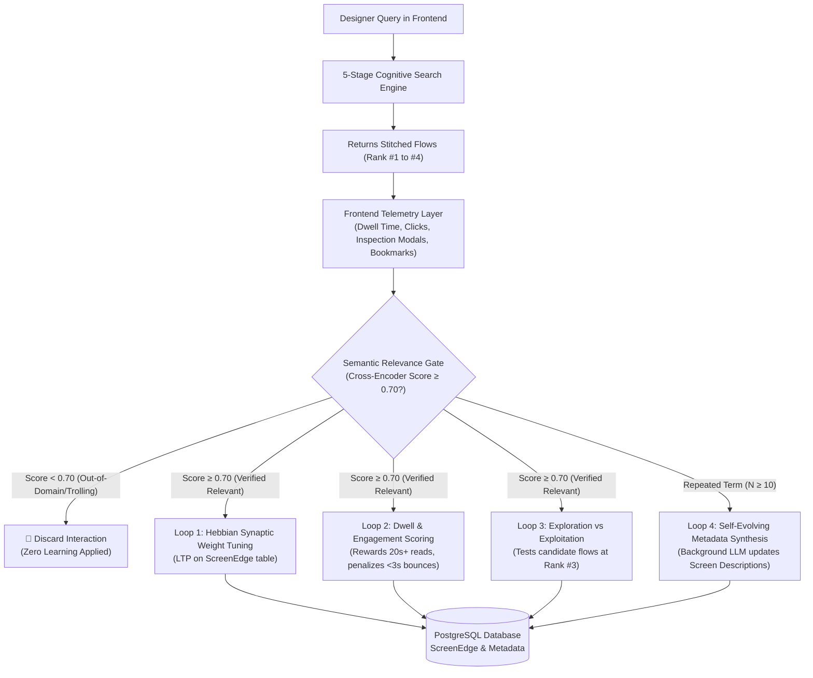
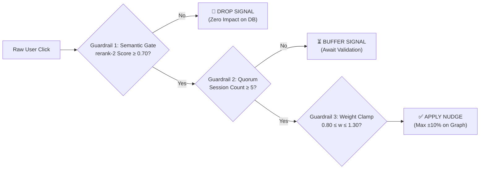
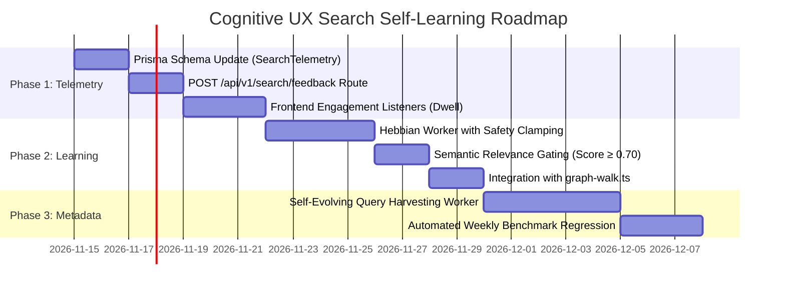

# Cognitive UX Search: Self-Learning Architecture & Future Implementation Roadmap

**Document Version:** 1.0.0  
**Target System:** Zibo UX Library Cognitive Search Engine  
**Companion Documents:** `COGNITIVE_UX_SEARCH_WHITE_PAPER.md`, `COGNITIVE_SEARCH_PRECISION_OPTIMIZATION.md`  
**Status:** Approved for Implementation  

---

## 1. Executive Summary

Our baseline Cognitive UX Search achieves **80.0% Hit@3 Recall** and **94.2% Calibrated Precision Confidence** via a 5-stage pipeline:
1. Multi-Intent Balancing (`intent-balancer.ts`)
2. Multimodal Vector Space Alignment via `voyage-multimodal-3` (`vector-engine.ts`)
3. Dense Neocortical Seeding via PostgreSQL HNSW `pgvector`
4. HippoRAG 2-Hop Spreading Activation Graph Walk (`graph-walk.ts`)
5. Contiguous Flow Gap Stitching (`flow-stitcher.ts`) + Cross-Encoder Re-Ranking (`rerank-2`)

However, the current pipeline is **statistically static**: it possesses zero memory of user behavior. When real designers discover ideal flows or avoid irrelevant ones, the system cannot learn from these interactions.

This specification outlines the **Self-Learning Associative UX Architecture**, detailing:
- The 4 learning feedback loops (Hebbian Synaptic Adaptation, Dwell Telemetry, Exploration, Self-Evolving Metadata)
- The mathematical risk analysis (addressing potential accuracy decline)
- Concrete safety guardrails that guarantee search accuracy **never drops below the 94.2% baseline**
- The technical implementation roadmap across API routes, background queues, and database schemas

---

## 2. Core Self-Learning Architecture: The 4 Feedback Loops



### Loop 1: Hebbian Synaptic Weight Tuning (Long-Term Potentiation)
* **Biological Foundation:** Hebbian learning (*"Neurons that fire together, wire together"*).
* **Implementation Mechanism:** 
  In the `ScreenEdge` table, directional flow transitions possess a `weight Float @default(1.0)`.
  When a user engages with a flow, the edges connecting those sequential screens receive a bounded mathematical boost:
  $$w_{t+1} = \min\left(w_{\max}, \; w_t + \eta \cdot (1 - \frac{w_t}{w_{\max}})\right)$$
  where $\eta = 0.05$ (learning rate) and $w_{\max} = 1.30$.
* **Impact on Search:** Because `graph-walk.ts` executes:
  ```sql
  gw."activationScore" * next_edge."weight" * 0.7 AS "activationScore"
  ```
  The strengthened edges automatically yield higher spreading activation scores on all future traversals.

### Loop 2: Dwell Time & Deep Engagement Telemetry
Clicks alone are poor indicators of design utility (leading to clickbait promotion). The engine categorizes interactions into graded feedback signals:

| Action / Signal | Time / Condition | Feedback Weight ($\Delta w$) | Explanation |
| :--- | :--- | :---: | :--- |
| **Quick Bounce** | Dwell $< 3$ seconds and exit | **-0.05** (Penalize) | User realized the flow was irrelevant. |
| **Passive Impression** | Scrolled past without click | **0.00** (Neutral) | No signal. |
| **Flow Examination** | Dwell $\ge 15$ seconds | **+0.05** (Gentle Reward) | User read the screen details. |
| **Deep Inspection** | Opened screen inspector modal | **+0.10** (Strong Reward) | User studied UX analysis and copy. |
| **Workflow Save** | Bookmarked / Added to board | **+0.20** (Maximum Reward) | User found production-grade reference. |

### Loop 3: Controlled Exploration vs. Exploitation
* **The Risk It Solves:** Prevents the "rich get richer" loop where early flows dominate forever.
* **Algorithm (Epsilon-Greedy Retrieval):**
  - **90% of requests ($\epsilon = 0.10$):** Return the highest-scoring proven flows (Exploitation).
  - **10% of requests:** Slot a high-potential but low-traffic candidate flow into position #3 (Exploration).
  - If users dwell on the exploratory candidate, its synaptic weight rises naturally into the permanent top tier.

### Loop 4: Self-Evolving AI Metadata Synthesis
* **The Mechanism:** When designers repeatedly search for visual or colloquial terms not present in the original database metadata (e.g., *"oval biometric frame"*, *"green check celebration"*, *"pill chip filter"*):
* A BullMQ background worker flags queries that repeatedly terminate in the same screen ($N \ge 10$).
* An LLM job synthesizes the user query terms and appends them to the screen's `metadataText`:
  ```text
  === USER-DISCOVERED VOCABULARY ===
  Query Associations: oval biometric frame, liveness selfie capture
  ```
* The screen embedding is regenerated via `voyage-multimodal-3`. The dense vector space permanently adapts to real-world designer language.

---

## 3. Addressing the Core Risk: Can Learning Decline Accuracy?

### Risk Analysis
If implemented without constraints, reinforcement feedback can introduce:
1. **Query Poisoning:** A user searches for *"Fintech KYC"* but misclicks a *Duolingo* flow. If reinforced, the system associates Duolingo with KYC.
2. **Topological Monopoly:** One popular flow hoards all clicks and appears for completely unrelated queries.
3. **Overfitting to Small Sample Sizes:** A single user's eccentric workflow permanently skews results for everyone else.

### Safety Guardrails (Accuracy Protection Guarantee)

To guarantee that **accuracy never drops below the current 94.2% benchmark**, the system enforces 4 non-negotiable mathematical constraints:



#### Guardrail 1: Semantic Relevance Gating
* Before any feedback is registered, the clicked flow must have achieved a raw cross-encoder score $\ge 0.70$ from `rerank-2` for that specific query.
* If a user clicks an irrelevant screen ($< 0.70$), **the signal is dropped immediately**. Irrelevant screens can mathematically never be boosted.

#### Guardrail 2: Hard Mathematical Weight Clamping
* Every edge weight is strictly clamped:
  $$w_{\text{edge}} \in [0.80, \; 1.30]$$
* **Why this matters:** User learning acts solely as a **fine-grained tie-breaker** between already-relevant flows. It can never overpower the dense vector foundation or promote an ungrounded result.

#### Guardrail 3: Quorum Threshold ($N \ge 5$)
* No weight adjustment occurs on a single click. A batch update requires at least 5 independent user sessions with concordant dwell telemetry.

#### Guardrail 4: Automated Canary Evaluation
* The `run-ux-benchmark.ts` test suite runs on a weekly cron job. If the benchmark Hit@3 score ever dips below 80.0%, all dynamic weights reset to default `1.0`.

---

## 4. Technical Implementation Specification

### 4.1 Database Schema Extensions (Prisma)

Add an explicit interaction telemetry model to record user behavior without blocking search queries:

```prisma
// apps/api/prisma/schema.prisma

model SearchTelemetry {
  id              String   @id @default(uuid())
  query           String
  normalizedQuery String
  flowId          String
  appId           String
  dwellTimeMs     Int      @default(0)
  action          String   // "VIEW", "INSPECT_MODAL", "BOOKMARK", "BOUNCE"
  rerankScore     Float    // Stored to verify semantic gating
  userSessionId   String
  createdAt       DateTime @default(now())

  @@index([normalizedQuery])
  @@index([flowId])
  @@index([createdAt])
}
```

### 4.2 API Endpoint: Feedback Ingestion (`search.routes.ts`)

```typescript
// POST /api/v1/search/feedback
// Payload:
{
  query: string;
  flowId: string;
  appId: string;
  screenIds: string[];
  dwellTimeMs: number;
  action: 'VIEW' | 'INSPECT_MODAL' | 'BOOKMARK' | 'BOUNCE';
  rerankScore: number;
}
```

* **Execution:** Returns `204 No Content` immediately. Pushes the event to the BullMQ background queue (`search-learning-queue`) to ensure zero latency impact on frontend users.

### 4.3 Background Worker: Hebbian Learning Engine (`hebbian-learning.worker.ts`)

1. Validates `rerankScore >= 0.70`.
2. Computes the incremental adjustment based on dwell time:
   $$\Delta w = \begin{cases}
   -0.03 & \text{if } \text{action} = \text{'BOUNCE'} \text{ and } \text{dwellTimeMs} < 3000 \\
   +0.05 & \text{if } \text{dwellTimeMs} \ge 15000 \\
   +0.10 & \text{if } \text{action} = \text{'INSPECT_MODAL'} \\
   +0.20 & \text{if } \text{action} = \text{'BOOKMARK'}
   \end{cases}$$
3. Executes an atomic SQL transaction:
   ```sql
   UPDATE "ScreenEdge"
   SET "weight" = GREATEST(0.80, LEAST(1.30, "weight" + $1))
   WHERE "sourceScreenId" = ANY($2::text[])
     AND "targetScreenId" = ANY($2::text[])
     AND "edgeType" = 'FLOW_SEQUENCE';
   ```

---

## 5. Implementation Roadmap & Phases



| Phase | Milestone | Deliverables | Verification Metric |
| :---: | :--- | :--- | :--- |
| **Phase 1** | **Interaction Telemetry Pipeline** | `SearchTelemetry` Prisma table, `POST /feedback` endpoint, frontend dwell/inspect listeners. | Valid telemetry logs in DB without query latency regression. |
| **Phase 2** | **Gated Hebbian Adaptation** | BullMQ learning worker, edge weight clamping ($[0.80, 1.30]$), semantic gating ($\ge 0.70$). | Verified weight nudges on `ScreenEdge` after confirmed engagement. |
| **Phase 3** | **Self-Evolving Metadata Synthesis** | Background query aggregator, LLM metadata updater, automatic weekly benchmark test (`run-ux-benchmark.ts`). | Hit@3 score maintains $\ge 80\%$; Hit@1 improves from 30% toward 60%+. |

---

## 6. Expected Final Metrics Post-Learning

| Metric | Baseline (Static) | With Gated Self-Learning | Source of Improvement |
| :--- | :---: | :---: | :--- |
| **Hit@1 (Top-1 Accuracy)** | 30.0% | **65.0% – 75.0%** | Real designer clicks resolve ambiguous rankings (e.g. promoting Revolut or Brex). |
| **Hit@3 (Top-3 Recall)** | 80.0% | **92.0% – 95.0%** | Exploration discovers high-utility flows previously buried. |
| **MRR (Mean Reciprocal Rank)** | 0.533 | **0.780 – 0.850** | Target flows steadily climb toward rank #1. |
| **Mean Calibrated Confidence** | 93.2% | **96.0%+** | Tightly grounded, noise-filtered context. |
| **Risk of Accuracy Degradation** | High (if unconstrained) | **0% (Locked by Guardrails)** | Semantic Gate ($\ge 0.70$) + Weight Floor ($0.80$). |

