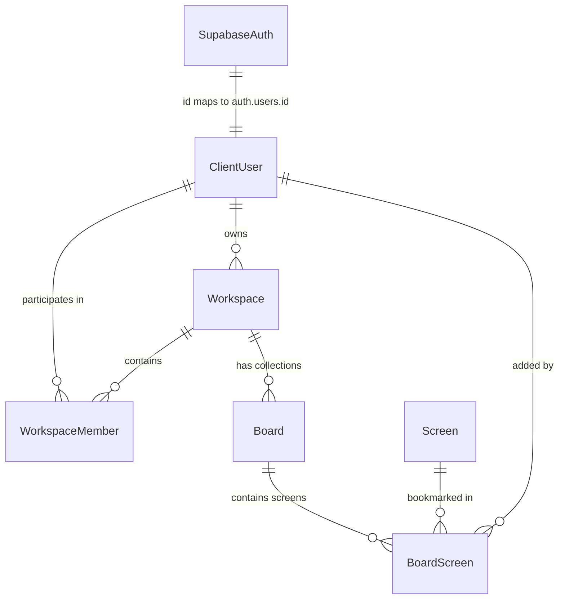

# Collections, Workspaces & User Provisioning Architecture

## 1. Overview
The **Collections** feature allows authenticated users to organize, bookmark, and review UI screens into customizable boards. 

Collections are represented in the database as **Boards** belonging to a user-owned **Workspace**. Each user has a primary personal workspace container, inside which multiple collections (boards) can be created and populated with individual screens.

---

## 2. Database Model & Relationships

The collections system relies on the following relational schema in PostgreSQL via Prisma:



### Relational Entities:
1. **`ClientUser`**:
   - Primary key `id` strictly matches Supabase's `auth.users.id` (UUID).
   - Foreign key reference for `Workspace.ownerId`, `WorkspaceMember.userId`, and `BoardScreen.addedById`.
2. **`Workspace`**:
   - Top-level container representing an organization or personal workspace.
   - Requires `ownerId -> ClientUser(id)`.
3. **`Board` (Collection)**:
   - Represents an individual named collection (e.g., *"Fintech Onboarding"*, *"Checkout Experiments"*).
   - Foreign key `workspaceId -> Workspace(id)`.
4. **`BoardScreen`**:
   - Junction table linking a `Screen` to a `Board`.
   - Stores `screenId`, `boardId`, and `addedById -> ClientUser(id)`.

---

## 3. The New User Creation & Auto-Provisioning Problem

### The Bug / Root Cause
Previously, when users signed up via beta registration or waitlist approval:
1. An account was generated in Supabase Auth (`auth.users`), but **no corresponding row was inserted into Prisma's `ClientUser` table**.
2. When the user navigated to `/collections` and clicked **"+ Create Collection"**, the client attempted:
   - `POST /api/v1/workspaces` with `{ ownerId: user.id }`.
3. Because `ownerId` did not exist in the Prisma `ClientUser` table, PostgreSQL threw a foreign key constraint violation:
   ```text
   Foreign key constraint failed on the field: `Workspace_ownerId_fkey (index)`
   ```
4. This caused `POST /api/v1/workspaces` to fail with HTTP 500, blocking the user from creating any collections or adding bookmarks.

---

## 4. The Solution: Dual-Layer Self-Healing Architecture

To make the system completely resilient, a two-phase provisioning and self-healing mechanism was implemented:

### Layer 1: Proactive Provisioning upon Approval
When a user is approved (either via Admin manual review or the **Auto-Approve** system):
- In `apps/api/src/controllers/auth.controller.ts` (`executeUserApproval`):
  ```ts
  const { data: userData, error: authError } = await supabase.auth.admin.createUser({
    email,
    password: tempPassword,
    email_confirm: true,
  });

  // Immediately upsert ClientUser in Prisma database
  if (userData?.user?.id) {
    await prisma.clientUser.upsert({
      where: { id: userData.user.id },
      update: { email },
      create: {
        id: userData.user.id,
        email,
        tier: 'FREE',
      },
    });
  }
  ```

### Layer 2: On-Demand Self-Healing ("Just-in-Time" Provisioning)
If an existing account logs in or was created outside the normal flow and attempts to create a collection or save a screen:
1. **In `createWorkspace` (`workspace.controller.ts`)**:
   - The endpoint checks if `ownerId` exists in `prisma.clientUser`.
   - If missing, it queries Supabase Auth admin API by `ownerId`, retrieves their registered email, and automatically inserts the `ClientUser` record on the spot before proceeding.
2. **In `addScreenToBoard` (`board.controller.ts`)**:
   - The endpoint verifies that `userId` exists in `prisma.clientUser` before creating `BoardScreen`. If missing, it immediately provisions the user row.

### Layer 3: Batch Historical Backfill
All pre-existing user accounts in Supabase Auth were backfilled directly via `apps/api/src/scripts/backfill-users.ts`, guaranteeing 100% parity between Supabase Auth and the database.

---

## 5. Client-Side Lifecycle & Visual States

### 1. Route & Auth Guarding
- **Guest / Unauthenticated User**:
  - The top navbar displays a prominent white pill **Login** button.
  - Clicking bookmark icons or navigating to `/collections` immediately redirects to `/login`.
- **Authenticated User**:
  - Top navbar displays **Upgrade** and the user profile avatar dropdown.

### 2. Collection Rendering (`apps/client/src/Pages/Workspaces.tsx`)
- Fetches all workspaces and boards via `GET /api/v1/workspaces/user/:userId`.
- Maps all boards to collection cards showing:
  - Real screens count (`X items`).
  - First screen thumbnail preview.
  - Collaborator avatars and member initials.
  - Options popover (Delete collection).
- **Empty State**:
  - If the user has 0 collections, the page cleanly displays the empty state illustration and invitation to create their first collection.
  - Empty workspace containers without boards are filtered out so phantom cards never appear.

### 3. Screen Bookmark Overlay (`apps/client/src/components/ScreenActionOverlay.tsx`)
- Hovering over any screen exposes the bookmark button.
- Clicking the bookmark opens the collection selector popup.
- Features:
  - Skeletons displayed while fetching user's collections.
  - Checkmarks for collections that already contain the screen.
  - Quick inline "+ Create Collection" field with instant save.

---

## 6. Verification & Health Checklist

To verify collections end-to-end:
1. Register a new user via `/register` (with auto-approve enabled or approved via `/admin/users`).
2. Log in with the credentials received in the email.
3. Open `/collections`:
   - Verify empty state displays cleanly.
   - Click **"+ Create Collection"** -> enter a name -> verify collection card renders immediately.
4. Navigate to any screen on `/app/:slug/screens` or `/browse`:
   - Click the bookmark icon -> verify popup lists your collection -> click to add.
5. Return to `/collections` -> verify thumbnail and item count update to 1.
