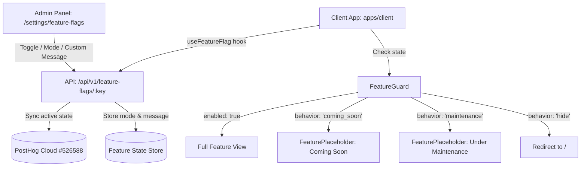

# Feature Flag & Release Control System

## 1. Overview
Zibo features an extensible **Release Control & Feature Flag system** managed directly through the **Internal Admin Panel** and synchronized with **PostHog**. 

Instead of completely deleting or removing an unfinished or paused feature from navigation, administrators can choose how disabled features appear to users:
1. **LIVE (ON)**: Full feature access for all users.
2. **Coming Soon (OFF)**: Keeps the navigation tab visible with a `SOON` pill badge and displays a curated coming-soon card with a custom message.
3. **Under Maintenance (OFF)**: Displays a `PAUSED` pill badge with a maintenance notice and custom explanation.
4. **Hide Completely (OFF)**: Removes the tab and redirects direct URL visits to the home library.

---

## 2. Architecture Diagram



---

## 3. How to Control Features from the Admin Panel

Navigate to **Admin Panel $\rightarrow$ Settings $\rightarrow$ Feature Flags** (`/settings/feature-flags`).

Each feature card provides:
1. **The Main Switch**: Toggle between **LIVE** and **OFF**.
2. **When OFF Selector**:
   - 🌟 **Coming Soon**: Keeps the tab in Navbar with a subtle purple `SOON` badge.
   - 🔧 **Under Maintenance**: Keeps the tab with an amber `PAUSED` badge.
   - 👁️ **Hide Completely**: Completely removes the tab from navigation.
3. **Custom Message Input**:
   - Write any message (e.g. *"Design Agent Studio is undergoing model updates. Back in 2 hours!"*).
   - Click **Save** to publish the message instantly to all visitors in real-time.

---

## 4. How to Add New Features in the Future

### Step 1: Add Feature to `KNOWN_FEATURES`
In [`apps/api/src/controllers/feature-flag.controller.ts`](file:///c:/projects/ux-libaray/apps/api/src/controllers/feature-flag.controller.ts):

```typescript
export const KNOWN_FEATURES = [
  // ...
  {
    key: 'export-figma',
    name: 'Export to Figma',
    description: 'Allows exporting screens directly to Figma canvas.',
    defaultValue: false,
    defaultBehavior: 'coming_soon',
    defaultMessage: 'Figma export is coming in our next major release!',
  },
];
```

### Step 2: Guard the Route in `App.tsx`
In [`apps/client/src/App.tsx`](file:///c:/projects/ux-libaray/apps/client/src/App.tsx):

```tsx
<Route 
  path="/figma" 
  element={
    <FeatureGuard flagKey="export-figma" title="Export to Figma">
      <FigmaPage />
    </FeatureGuard>
  } 
/>
```

### Step 3: (Optional) Show in Navbar
In [`apps/client/src/components/Layout/Navbar.tsx`](file:///c:/projects/ux-libaray/apps/client/src/components/Layout/Navbar.tsx):

```tsx
const figmaFlag = useFeatureFlag('export-figma', false);

{figmaFlag.enabled || figmaFlag.behavior !== 'hide' ? (
  <Link to="/figma">
    <span>Figma</span>
    {!figmaFlag.enabled && (
      <span className="badge">{figmaFlag.behavior === 'maintenance' ? 'PAUSED' : 'SOON'}</span>
    )}
  </Link>
) : null}
```

---

## 5. Key Files Reference

- **Backend Controller**: [`apps/api/src/controllers/feature-flag.controller.ts`](file:///c:/projects/ux-libaray/apps/api/src/controllers/feature-flag.controller.ts)
- **Admin Switch & Message Editor**: [`apps/admin/src/features/settings/feature-flags/index.tsx`](file:///c:/projects/ux-libaray/apps/admin/src/features/settings/feature-flags/index.tsx)
- **Client Reactive Hook**: [`apps/client/src/hooks/useFeatureFlag.ts`](file:///c:/projects/ux-libaray/apps/client/src/hooks/useFeatureFlag.ts)
- **Placeholder UI**: [`apps/client/src/components/FeaturePlaceholder.tsx`](file:///c:/projects/ux-libaray/apps/client/src/components/FeaturePlaceholder.tsx)
- **Route Guard Wrapper**: [`apps/client/src/App.tsx`](file:///c:/projects/ux-libaray/apps/client/src/App.tsx)
