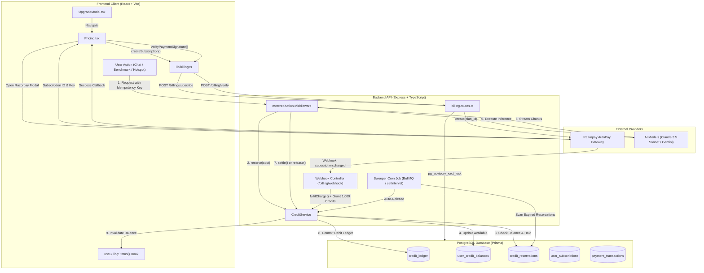

# Zibo Payments & AI Credit Metering Architecture

This document specifies the end-to-end payment processing, subscription lifecycle, concurrency invariants, REST API contract, and frontend payment architecture implemented across Zibo's backend (`apps/api`) and client (`apps/client`).

---

## 1. Executive Summary & Core Invariants

The Zibo monetization architecture unites **Razorpay Subscriptions (AutoPay e-Mandate)** and a **Double-Entry Reservation-Based Credit Ledger** to guarantee sub-millisecond AI capability gating, zero double-debiting under concurrency, and automated monthly quota replenishment.

### Mathematical Invariants

| ID | Name | Mathematical / System Formulation | Enforcement Mechanism |
| :--- | :--- | :--- | :--- |
| **I1** | **Conservation of Credits** | $\text{Balance}(u) = \sum \Delta_{\text{ledger}}(u)$ | PostgreSQL `UserCreditBalance` is an atomic view strictly updated via `credit_ledger` transactions. |
| **I2** | **Strict Non-Negativity** | $\text{Balance}(u) \ge 0 \quad \forall u, \forall t$ | `apply()` checks `balanceBefore + delta >= 0` with row-level locks (`SELECT ... FOR UPDATE`). |
| **I3** | **Idempotent Ledger** | $\forall k: \text{apply}(\Delta, k) \implies \text{applied once}$ | Unique constraint on `(user_id, idempotency_key)` in `credit_ledger`. |
| **I4** | **Reservation Isolation** | $\text{Available}(u) = \text{Balance}(u) - \sum \text{PendingReservations}(u)$ | `reserve()` moves credits to a `HELD` state before AI inference starts. |
| **I5** | **Zero-Leak Safety** | $\forall r \in \text{Reservations}: r \to \{\text{SETTLED}, \text{RELEASED}\}$ | Sweeper worker runs every 60s to release dangling reservations whose timeout expired. |

---

## 2. System Architecture Diagram



---

## 3. Subscription & Payment Engine

### 3.1 Supported Plans

| Plan Code | Display Name | Billing Cycle | Price (INR / USD) | Monthly AI Quota | Benefits |
| :--- | :--- | :--- | :--- | :--- | :--- |
| `hobby` | **Hobby** | Forever Free | ₹0 / $0 | 50 Welcome Credits + 5 Insights/mo | 1 benchmark/mo, 4-screen preview of Paid apps, browse free library |
| `pro` (`PRO_MONTHLY`) | **PRO Monthly** | Monthly AutoPay | ₹1,499 / $19 | 1,000 Credits / month | Unlimited Paid apps, 10 benchmarks, 50 insights, Claude 3.5 Sonnet analysis |
| `pro_annual` (`PRO_ANNUAL`) | **PRO Yearly** | Annual AutoPay | ₹14,388 (₹1,199/mo) / $144 | 1,000 Credits / month | All PRO features + 40% annual discount |

### 3.2 Dual-Tier Concurrency Safeguards

1. **Parallel Checkout Serialization (`pg_advisory_xact_lock`)**:
   - When a user clicks "Start With PRO" repeatedly or across multiple tabs, `POST /api/v1/billing/subscribe` hashes the user ID:
     $$\text{lockKey} = |\text{MD5}(\text{userId})[0..3]|$$
   - The transaction executes `SELECT pg_advisory_xact_lock(lockKey)`. Only one checkout creation proceeds; concurrent calls detect the pending subscription or reuse an existing `INCOMPLETE` record created within 24 hours.
2. **Webhook & Fast-Path Fulfillment Race (`fulfilCharge`)**:
   - Both the Razorpay webhook (`subscription.charged`) and the client fast-path polling trigger `fulfilCharge()`.
   - The fulfillment creates a credit grant with `idempotencyKey = pay:${paymentId}` inside a database transaction. Whichever finishes first commits the 1,000 credits; the second execution encounters the unique constraint and safely exits as a no-op.

---

## 4. API Endpoints Specification

All authenticated billing endpoints require a valid Supabase JWT bearer token passed in the `Authorization: Bearer <token>` header.

### 4.1 `POST /api/v1/billing/subscribe`
Creates a Razorpay AutoPay subscription for the authenticated user with concurrency protection.

- **Request Body**:
  ```json
  {
    "planCode": "PRO_MONTHLY", // or "PRO_ANNUAL"
    "currency": "INR"
  }
  ```
- **Response `200 OK`**:
  ```json
  {
    "subscriptionId": "sub_Q1a2B3c4D5e6F7",
    "razorpaySubscriptionId": "sub_Q1a2B3c4D5e6F7",
    "keyId": "rzp_live_xxxxxxxxxxxx",
    "currency": "INR",
    "amountMinor": 149900,
    "planPriceId": "price_pro_monthly_inr"
  }
  ```
- **Response `409 Conflict` (Already Active)**:
  ```json
  {
    "error": "ALREADY_SUBSCRIBED",
    "message": "You already have an active subscription."
  }
  ```

---

### 4.2 `POST /api/v1/billing/verify`
Verifies the cryptographic HMAC SHA-256 signature generated by Razorpay's checkout modal upon payment authorization.

- **Request Body**:
  ```json
  {
    "razorpay_payment_id": "pay_XYZ123456789",
    "razorpay_subscription_id": "sub_Q1a2B3c4D5e6F7",
    "razorpay_signature": "e3b0c44298fc1c149afbf4c8996fb92427ae41e4649b934ca495991b7852b855"
  }
  ```
- **Response `200 OK`**:
  ```json
  {
    "status": "PROCESSING",
    "message": "Signature verified. Awaiting fulfillment."
  }
  ```
- **Response `400 Bad Request`**:
  ```json
  {
    "error": "INVALID_SIGNATURE"
  }
  ```

---

### 4.3 `GET /api/v1/billing/status`
Returns the user's active tier, current credit balance, and latest subscription details.

- **Headers**: `Authorization: Bearer <token>`
- **Response `200 OK`**:
  ```json
  {
    "tier": "PRO",
    "creditsBalance": 975,
    "subscription": {
      "id": "sub_local_uuid",
      "status": "ACTIVE",
      "entitledUntil": "2026-12-11T22:00:00.000Z",
      "planName": "PRO Monthly"
    }
  }
  ```

---

### 4.4 `POST /api/v1/billing/webhook`
Receives asynchronous server-to-server webhook notifications from Razorpay.

- **Headers**: `X-Razorpay-Signature: <hex_digest>`
- **Key Events Handled**:
  - `subscription.charged`: Invokes `fulfilCharge()`, updates `entitledUntil`, and grants 1,000 credits.
  - `subscription.halted`: Updates subscription status to `PAST_DUE`.
  - `subscription.cancelled`: Sets status to `CANCELLED`; user retains access until `entitledUntil`.
- **Response `200 OK`**:
  ```json
  {
    "received": true
  }
  ```

---

### 4.5 AI Metered Endpoints (`/api/v1/ai/*`)
All AI routes (`/ai/chat/message`, `/ai/benchmark`, `/ai/insights`, `/ai/inspect`, etc.) are intercepted by `meteredAction(actionType)`.

- **Response `402 Payment Required` (Insufficient Quota)**:
  ```json
  {
    "error": "INSUFFICIENT_CREDITS",
    "message": "You need 5 credits for this action but only have 2 available.",
    "required": 5,
    "available": 2
  }
  ```
- **Response `403 Forbidden` (Locked Feature for Tier)**:
  ```json
  {
    "error": "FEATURE_LOCKED",
    "message": "This feature requires a Zibo PRO subscription.",
    "upgradeUrl": "/pricing"
  }
  ```

---

## 5. Frontend Payment Architecture

The frontend payment system is structured around three synchronized layers:

```
┌────────────────────────────────────────────────────────┐
│                   UI Presentation Layer                 │
│  • UpgradeModal.tsx (dual-card trigger on 402/403)     │
│  • Pricing.tsx (full Figma Desktop-147 flow)           │
│  • StickyChatInput.tsx / AiContextButton (live pill)   │
└───────────────────────────▲────────────────────────────┘
                            │
┌───────────────────────────┴────────────────────────────┐
│                    State & Context Layer               │
│  • UpgradeContext.tsx (openUpgradeModal / modal state) │
│  • useBillingStatus.ts (React Query ['billing-status'])│
│  • useAIChatStore.ts (reactive cache invalidation)     │
└───────────────────────────▲────────────────────────────┘
                            │
┌───────────────────────────┴────────────────────────────┐
│                  Network & SDK Driver Layer            │
│  • lib/billing.ts (createSub, verifySig, polling)      │
│  • utils/api.ts (Axios + auto Supabase JWT injection)  │
│  • window.Razorpay (Checkout Modal SDK)                │
└────────────────────────────────────────────────────────┘
```

### 5.1 Presentation Components
1. **[`UpgradeModal.tsx`](file:///c:/projects/ux-libaray/apps/client/src/components/Pricing/UpgradeModal.tsx)**:
   - Compact 888×589px dialog rendered above screens when locked items or zero credits are encountered.
   - Contains Hobby vs. PRO breakdown and routes directly to `/pricing` upon clicking "Get Started With PRO".
2. **[`Pricing.tsx`](file:///c:/projects/ux-libaray/apps/client/src/Pages/Pricing.tsx)**:
   - Full-page marketing and checkout interface (Figma `Desktop - 147`).
   - Features monthly/yearly billing toggle (with 40% discount calculation), comparison table, enterprise banner, and collapsible FAQ accordions.
   - Initializes `window.Razorpay` with theme color `#FF924A` and user email prefill.

### 5.2 Real-Time Reactive Quota Synchronization
In legacy polling models, users would spend credits but the UI would continue to show outdated balances until a hard browser refresh. Zibo prevents this via reactive cache invalidation:
- **`useBillingStatus()`**: Custom React Query hook backed by `queryClient`.
- Whenever an AI action finishes (stream end in `useAIChatStore.ts`, hotspot generation in `useScreenInsights.ts`, or element inspection in `useScreenInspect.ts`), `invalidateBillingStatus()` is called immediately.
- The credit pill in `StickyChatInput` and the workspace headers update their badges without any noticeable delay.

### 5.3 Fast-Path Checkout Polling
When a user completes payment in the Razorpay checkout popup:
1. `handler(response)` calls `verifyPaymentSignature()`.
2. The UI enters a polling state with `pollSubscriptionUntilActive()`, polling `GET /billing/status` every 2 seconds (up to 15 attempts).
3. As soon as the webhook or backend fast-path fulfiller activates the PRO subscription, the client displays a success notification and routes the user into the PRO app catalog.

---

## 6. AI Credit Rate Card & Token Valuation

Each user interaction consumes credits based on token complexity, model latency, and prompt overhead:

| Action Identifier | Action Name | Credit Cost | Max Timeout | Description & Scope |
| :--- | :--- | :---: | :---: | :--- |
| `WORKSPACE_CHAT` | AI Workspace Copilot | **10** | 120s | Multi-turn reasoning with full screen context and UI guidance |
| `BENCHMARK` | App Benchmarking Suite | **10** | 90s | Deep Claude 3.5 Sonnet comparative teardown against competitors |
| `BENCHMARK_CHAT` | Benchmark Follow-up | **5** | 60s | Q&A focused on an active benchmark report |
| `SCREEN_INSPECT` | Screen Element Teardown | **5** | 45s | Structural component, hierarchy, and micro-copy inspection |
| `SCREEN_INSIGHTS` | Interactive UI Hotspots | **5** | 45s | Coordinate-based visual hotspots & heuristic evaluation |
| `SCREEN_COMPARE` | Compare Mode Teardown | **8** | 60s | Side-by-side design contrast and differential feedback |
| `DETECT_CONTEXT` | Screen Intent Classifier | **5** | 30s | Automated UX pattern & screen flow tag detection |
| `IMPROVE_DESIGN` | Design Iteration Assist | **12** | 90s | Actionable redesign recommendations and copy improvements |
| `DESIGN_AGENT` | Design Agent Studio | **15** | 120s | Autonomous generative layout generation and component synthesis |

---

## 7. Reservation Lifecycle: Reserve $\to$ Settle $\to$ Release

To prevent credit leaks or negative balances from long-running LLM streams, Zibo uses a three-stage commit pattern.

```
       [ Client Request ]
               │
               ▼
        reserve(cost) ──(Insufficient Balance)──► 402 Insufficient Credits
               │
          (Credits Held)
               │
               ▼
     [ Stream LLM Tokens ]
         │            │
   (First Token)  (Error / Abort)
         │            │
         ▼            ▼
      settle()    release()
  (Debit Ledger) (Credits Returned)
```

### 7.1 Stage 1: Reserve (`reserve()`)
- Validates that `AvailableBalance >= ActionCost`.
- Generates a `CreditReservation` with status `HELD` and records the SHA-256 hash of the request payload (`hashPayload(action, body)`).
- If the exact same request key is submitted while `HELD`, returns status `in_progress` (deduplicating network retry storms).

### 7.2 Stage 2: Settle (`settle()`)
- Triggered as soon as the LLM outputs the first token or upon complete output delivery.
- Changes reservation status from `HELD` to `SETTLED`.
- Commits a negative delta (`-cost`) into `credit_ledger` under type `USAGE`.
- Updates `UserCreditBalance.balance` atomically.

### 7.3 Stage 3: Release (`release()`)
- If the model throws an error before generating meaningful output or if the network disconnects before stream initiation:
  - Reservation status transitions from `HELD` to `RELEASED`.
  - Zero credits are deducted from the ledger.
  - The held quota is restored to the user's available pool immediately.

### 7.4 Stage 4: Sweeper Auto-Recovery
- An automated background sweeper runs every 60 seconds.
- Queries all reservations in `HELD` status where `createdAt + timeoutMs < NOW()`.
- Releases the hold and marks the reservation as `EXPIRED_RELEASED`.

---

## 8. Database Entities (Prisma Schema Reference)

```prisma
enum LedgerType {
  GRANT
  USAGE
  REFUND
  EXPIRATION
  ADJUSTMENT
}

enum ReservationStatus {
  HELD
  SETTLED
  RELEASED
  EXPIRED_RELEASED
}

model UserCreditBalance {
  id        String   @id @default(uuid())
  userId    String   @unique
  balance   Int      @default(0)
  updatedAt DateTime @updatedAt
}

model CreditLedger {
  id             String     @id @default(uuid())
  userId         String
  delta          Int
  balanceAfter   Int
  type           LedgerType
  idempotencyKey String     @unique
  reservationId  String?
  reason         String?
  createdAt      DateTime   @default(now())

  @@index([userId, createdAt])
}

model CreditReservation {
  id          String            @id @default(uuid())
  userId      String
  requestKey  String            @unique
  actionType  String
  cost        Int
  status      ReservationStatus @default(HELD)
  payloadHash String
  timeoutMs   Int               @default(60000)
  createdAt   DateTime          @default(now())
  updatedAt   DateTime          @updatedAt

  @@index([userId, status])
}
```

---

## 9. Verification & Test Suite

The payments and metering engine is verified against the 15-case test matrix specified in the Zibo Implementation Plan:

| Test Case | Scenario Verified | Result |
| :--- | :--- | :--- |
| **TC-01** | Parallel Debit Race: 10 parallel requests with 5 credits balance | Exactly 1 succeeds, 9 receive 402, balance never drops below 0 |
| **TC-02** | Network Retry Storm: 5 identical requests with same `requestKey` | Exactly 1 reservation created, 4 deduplicated via `in_progress` |
| **TC-03** | Abort Policy: Stream aborted after token delivery | Settled correctly; usage charged for compute consumed |
| **TC-04** | Abort Policy: Stream aborted before first token | Released cleanly; user balance untouched |
| **TC-05** | Sweeper Recovery: Simulated crashed worker | Sweeper detects expired reservation and releases held credits |
| **TC-06** | Razorpay Webhook Replay: Duplicate `subscription.charged` events | Processed once; subsequent deliveries detected via idempotency key |
